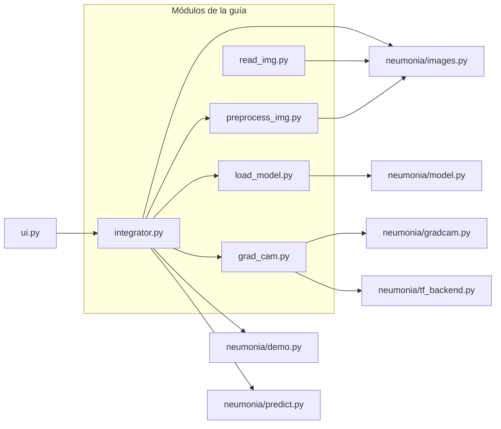

# Detección rápida de neumonía con Grad-CAM

[](https://www.python.org/)
[](https://github.com/astral-sh/uv)
[](https://github.com/astral-sh/ruff)
[](tests/)
[](LICENSE)

Herramienta de escritorio para clasificar radiografías de tórax en **neumonía
bacteriana**, **viral** o **sin neumonía**, explicando la decisión con un mapa de
calor **Grad-CAM**.

## Tabla de contenidos

- [Descripción](#descripción)
- [Características](#características)
- [Stack](#stack)
- [Requisitos](#requisitos)
- [Primeros pasos](#primeros-pasos)
- [Modo demo](#modo-demo-sin-modelo)
- [Uso de la interfaz](#uso-de-la-interfaz)
- [Estructura del proyecto](#estructura-del-proyecto)
- [Calidad y pruebas](#calidad-y-pruebas)
- [Arquitectura del modelo](#arquitectura-del-modelo)
- [Acerca de Grad-CAM](#acerca-de-grad-cam)
- [Contribución](#contribución)
- [Licencia](#licencia)

## Descripción

Deep Learning aplicado al procesamiento de imágenes radiográficas de tórax en
formato DICOM con el fin de clasificarlas en tres categorías:

1. Neumonía bacteriana
2. Neumonía viral
3. Sin neumonía

Además aplica una técnica de explicación llamada **Grad-CAM** para resaltar con un
mapa de calor las regiones relevantes de la imagen de entrada.

## Características

- Lectura de imágenes **DICOM**, **JPG** y **PNG**.
- Preprocesamiento: `resize` 512×512, escala de grises, CLAHE y normalización.
- Predicción con una CNN preentrenada.
- Visualización **Grad-CAM** superpuesta.
- Reporte en **PDF** con los datos de la lectura y ambas imágenes.
- Lógica separada de la UI y **210+ pruebas unitarias** con pytest.
- Regla de dependencia: `ui.py` solo importa `integrator`, nunca TensorFlow ni `load_model`.
- **Modo demo** para probar la interfaz sin modelo ni dependencias `ml`.

## Stack

- Python 3.13 · `uv` · `hatchling` · Ruff · pytest · ty · pre-commit
- NumPy · Pillow · FastAPI · Uvicorn · ReportLab
- Extra `ml`: TensorFlow, OpenCV, pydicom
- Interfaz: HTML/CSS/JS embebido servido por FastAPI

## Requisitos

- [uv](https://docs.astral.sh/uv/) instalado.
- Para inferencia real: el modelo `WilhemNet86.h5` (no incluido en el repositorio)
  en la raíz del proyecto. El modo demo funciona sin él.

## Primeros pasos

```bash
git clone https://github.com/dalquinones/UAO-Neumonia.git
cd UAO-Neumonia

make install          # uv sync --extra ml
make run              # abre http://127.0.0.1:8000
```

> También puedes ejecutar directamente: `uv run python detector_neumonia.py`.
> Si instalaste solo el entorno base, añade DICOM/modelo con `uv sync --extra ml`.
> Tras editar `src/*.py`, refresca las copias con
> `uv sync --extra ml --reinstall-package neumonia`.

### Modo demo (sin modelo)

Si `WilhemNet86.h5` no está en la raíz, la casilla **Modo demostración** se activa
automáticamente. Carga una imagen JPG/PNG/DICOM y pulsa **Analizar imagen**: se
generan una etiqueta, una probabilidad y un mapa de calor **ilustrativos** usando
NumPy y Pillow, sin TensorFlow ni OpenCV para la explicación.

Puedes marcar o desmarcar la casilla en cualquier momento. Si la desmarcas sin el
modelo, la aplicación avisa en lugar de fallar. El modo demo queda señalado en el
resultado junto con el mapa de calor; **no es válido para diagnóstico**.

### Calidad y pruebas

```bash
make check            # lint + formato + tipos + pruebas
make test             # solo pruebas
make test-cov         # pruebas con cobertura
make help             # lista de objetivos disponibles
```

## Uso de la interfaz

1. Ingresa el identificador del paciente en la caja de texto.
2. Marca o desmarca **Modo demostración**: se activa solo si no hay modelo.
3. Selecciona o arrastra un estudio (DICOM/JPG/PNG).
4. Presiona **Analizar imagen**.
5. Compara el estudio cargado a la izquierda con el mapa de calor a la derecha.
6. Presiona **Informe PDF** para descargar datos y ambas imágenes.

Imágenes de prueba: <https://drive.google.com/drive/folders/1WOuL0wdVC6aojy8IfssHcqZ4Up14dy0g>

## Estructura del proyecto

```text
.
├── src/                   # módulos públicos exigidos por la guía
│   ├── load_model.py      # cargar el .h5 una sola vez
│   ├── read_img.py        # leer DICOM y JPEG
│   ├── preprocess_img.py  # resize 512×512, gris, CLAHE, normalizar
│   ├── grad_cam.py        # generar el mapa de calor
│   ├── integrator.py      # preprocesar → predecir → explicar; fachada para ui
│   ├── ui.py              # UI web FastAPI + HTML embebido (solo importa integrator)
│   └── neumonia/          # implementación canónica (src-layout)
│       ├── constants.py   # constantes del dominio
│       ├── labels.py      # índices → etiquetas
│       ├── images.py      # lectura y preprocesamiento
│       ├── gradcam.py     # matemática de Grad-CAM
│       ├── predict.py     # interpretación y orquestación
│       ├── applogic.py    # lógica de UI independiente del framework
│       ├── demo.py        # modo demo sin modelo ni dependencias ml
│       ├── model.py       # carga del modelo con caché (TF perezoso)
│       ├── tf_backend.py  # Grad-CAM con TensorFlow
│       └── app.py         # compatibilidad: reexporta ui.App
├── tests/                 # pruebas unitarias
├── tools/                 # utilidades del Makefile
├── docs/                  # documentación
├── detector_neumonia.py   # lanzador histórico
├── main.py                # alias de arranque
├── Makefile
├── pyproject.toml
└── CONSTITUTION.md        # fuente única de verdad
```

Los seis módulos directos en `src/` son la API pública exigida por la guía.
`ui.py` contiene la interfaz y solo depende de `integrator`; este concentra las
dependencias de inferencia y reexporta la implementación de `neumonia`.



## Arquitectura del modelo

La red neuronal convolucional (CNN) está basada en el modelo de F. Pasa,
V. Golkov, F. Pfeifer, D. Cremers & D. Pfeifer en su artículo *Efficient Deep
Network Architectures for Fast Chest X-Ray Tuberculosis Screening and
Visualization*.

Está compuesta por 5 bloques convolucionales, cada uno con 3 convoluciones: dos
secuenciales y una conexión *skip* que evita el desvanecimiento del gradiente a
medida que se avanza en profundidad. Con 16, 32, 48, 64 y 80 filtros de 3×3 para
cada bloque respectivamente.

Después de cada bloque convolucional hay una capa de max pooling y, después de la
última, una capa de average pooling seguida por tres capas fully-connected
(Dense) de 1024, 1024 y 3 neuronas. Para regularizar se usan 3 capas de Dropout al
20 %: dos en los bloques 4 y 5 y otra después de la primera capa Dense.

## Acerca de Grad-CAM

Grad-CAM resalta las regiones de una imagen que son importantes para la
clasificación. Calcula el gradiente de la salida correspondiente a la clase con
respecto a las neuronas de una capa convolucional y combina linealmente los mapas
de activación con esos pesos, produciendo un mapa de calor con mayor intensidad en
las regiones relevantes para la decisión de la red.

## Contribución

Consulta [`CONTRIBUTING.md`](CONTRIBUTING.md). Usa **Conventional Commits** y
asegúrate de que `make check` pase antes de abrir un Pull Request.

## Licencia

Distribuido bajo licencia **MIT**. Ver [`LICENSE`](LICENSE).

## Proyecto original

- Isabella Torres Revelo — <https://github.com/isa-tr>
- Nicolas Diaz Salazar — <https://github.com/nicolasdiazsalazar>
